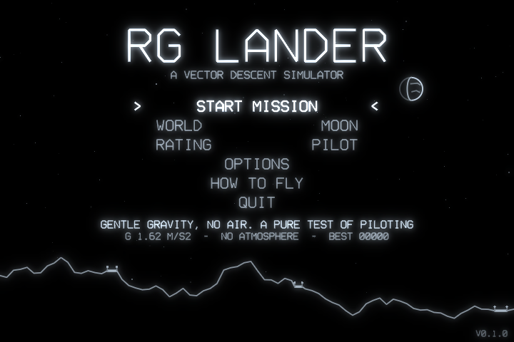
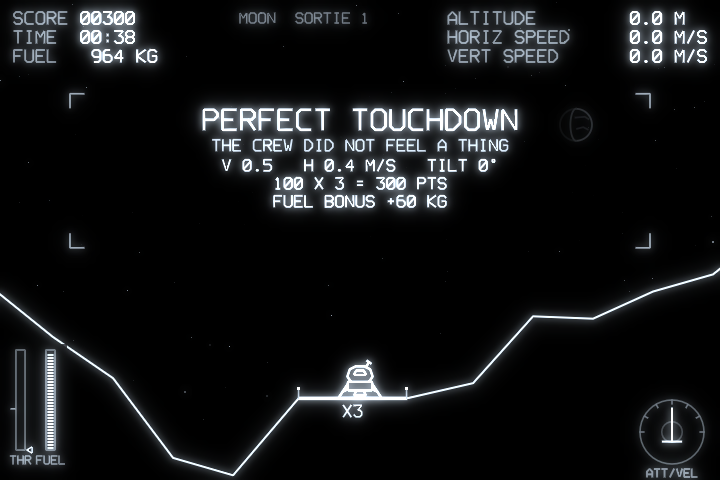
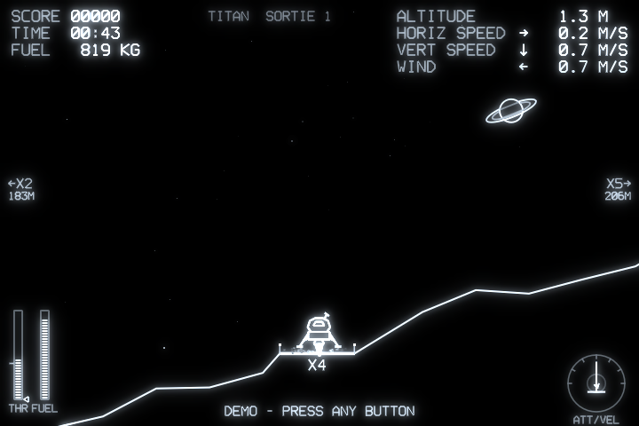
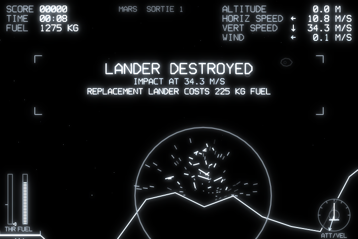

# RG Lander

A vector-graphics landing game for LÖVE 11, made for the **Anbernic RG34XXSP**
(720×480, Allwinner H700, PortMaster). It is an original game in the classic
lunar-lander genre: monochrome phosphor lines on black, jagged procedural
terrain, narrow pads that pay more, and fuel as your only life.

| | |
|---|---|
|  |  |
|  |  |

*Screenshots are rendered by the game itself at native 720×480 (`--shot`). The
green phosphor option is shown in [mars_green.png](screenshots/mars_green.png).*

## Running

| Where | How |
|---|---|
| Desktop | `love .` (LÖVE 11.4/11.5) |
| Any LÖVE | `./build.sh`, then `love dist/rglander.love` |
| RG34XXSP | download `rglander_v*_portmaster.zip` from Releases (or run `./build.sh`), unzip it into the SD card's `ports/` folder (it contains `RG Lander.sh` and `rglander/`), refresh the game list, and launch **RG Lander** from Ports |

The launcher uses PortMaster's `love_11.5` runtime. If you have never installed
a LÖVE-based port, install that runtime from PortMaster first, or the launcher
will show a message and exit. Logs go to `ports/rglander/log.txt`, and
settings and high scores to `ports/rglander/conf/`.

## Controls

| Input | Action |
|---|---|
| D-pad ←/→ or L1/R1 | Rotate (RCS jets) |
| D-pad ↑/↓ | Set the throttle lever (it stays where you leave it) |
| A (hold) | Full thrust |
| B | Cut the lever to zero |
| X | Set the lever to hover thrust for your current mass |
| Left stick | Rotate (X) and analog thrust (push up) |
| R2 / right stick up | Analog thrust |
| Start / Select | Pause |
| Select + Start | Quit |
| Y | Toggle FPS counter |

Keyboard (desktop): arrows, Z = A, X = B, C = X, Q/E = L1/R1, Enter = Start, Esc = Select.

## Physics

Everything is in SI units, integrated at a fixed 120 Hz (semi-implicit Euler).

- **Rocket with changing mass.** Mass is 2000 kg dry plus propellant. Thrust
  burns `F / ve` kg/s with `ve` = 2000 m/s, so the rocket equation emerges
  on its own: as fuel burns, the lander gets lighter, accelerates harder and
  rotates faster. The HUD's hover marker (X button) follows this.
- **Engine** sized to a thrust-to-weight ratio of 2.4 at full mass for each world
  (with a minimum of 2 m/s², so low gravity is still flyable). It has a 0.12 s spool lag.
- **Attitude** comes from RCS torque against a moment of inertia `I = m·k²`. *Assisted*
  mode treats input as a rotation-rate command and stops the spin when you let go.
  *Manual* mode is raw torque, so rotation keeps going until you counter it.
- **Atmosphere** adds quadratic drag `½ρ·CdA·|v−wind|·(v−wind)`, gusty
  wind that weakens near the ground, and aerodynamic damping of rotation.
- **Particles** follow the same physics. In vacuum, dust kicked up by the exhaust
  flies in clean ballistic arcs. On Titan it slows down quickly and drifts with the wind.
- **Touchdown** is judged on vertical speed, horizontal speed and tilt (PILOT limits:
  2.0 m/s, 1.0 m/s, 5°; up to 3.5 m/s counts as a hard landing). Both feet must be on
  a pad or on level ground. A hull or strut touching terrain destroys the lander.

| World | g (m/s²) | Air (kg/m³) | Character |
|---|---|---|---|
| Moon | 1.62 | none | The baseline |
| Mars | 3.71 | 0.020 | Heavy and fast; the thin air barely helps |
| Titan | 1.35 | 5.3 | Drag caps your fall around 10 m/s, and the wind pushes you |
| Ceres | 0.28 | none | Floaty; landing takes fine throttle control |

## Built for the handheld

- **Screen.** Drawn natively at 720×480 into a canvas, then shown 1:1. Text is a
  vector stroke font, 12 px tall in the HUD (about 1.2 mm on the 3.4" panel).
  Warnings blink instead of changing colour, as on a monochrome vector monitor.
- **4:3 option.** Some reviewers say the RG34XXSP panel is physically 4:3 with
  non-square pixels. If the planet in the sky looks oval, set *Options → Screen → 4:3*.
  The game then renders at 640×480 and stretches it to fill the panel.
- **Camera.** It keeps the lander and the ground beneath it in frame, and zooms
  smoothly from 1.5 to 6 px/m as you descend. The lander art never drops below
  2.6 px/m on screen, so it stays readable at high altitude. Edge markers point
  to off-screen pads.
- **Performance.** The bloom is two small separable blurs (1/2 and 1/4 resolution)
  in GLSL ES 1.0. *Options → Glow* lowers or disables it. Particles use pooled arrays
  so the garbage collector stays quiet. Audio is synthesised at start-up, so
  there are no asset files.
- **Input.** SDL gamepad first. On the device, if a gamepad is detected, keyboard
  events from gptokeyb are ignored so no button is read twice.

## Development

```sh
love . --autotest 40                      # headless: autopilot flies 40 sorties per world
love . --shot NAME --mode game --world 3 --time 20 --turbo 4 --seed 9
                                          # saves NAME.png to the LÖVE save dir
                                          # modes: title options howto game crash pause gameover
love . --shot x --mode title --opt phosphor=2 --opt aspect=2   # test-only setting overrides
```

Test runs never write to the settings file.

```
main.lua        window, render pipeline (scene → bloom → screen), test harness
conf.lua        LÖVE config
src/game.lua    sorties, camera, contact/touchdown, scoring, debris, autopilot
src/lander.lua  geometry, flight physics, drawing
src/terrain.lua periodic midpoint-displacement terrain, craters, pads
src/hud.lua     instruments, attitude/velocity gauge, messages
src/title.lua   menus, options, how-to, attract mode
src/worlds.lua  world data and schematic sky objects
src/scene.lua   stars, terrain and pad drawing
src/particles.lua, glow.lua, audio.lua, vfont.lua, input.lua, settings.lua, core.lua
port/           PortMaster launcher
```
